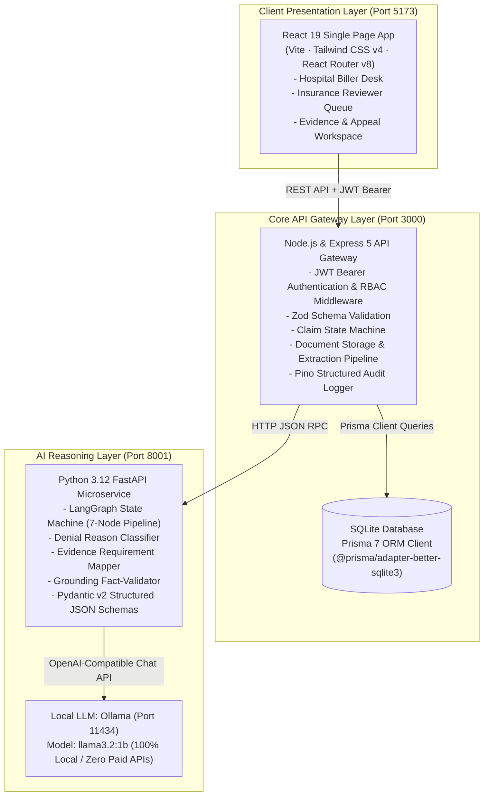
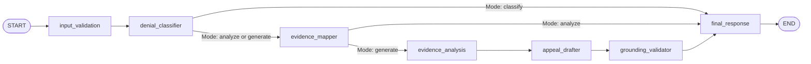
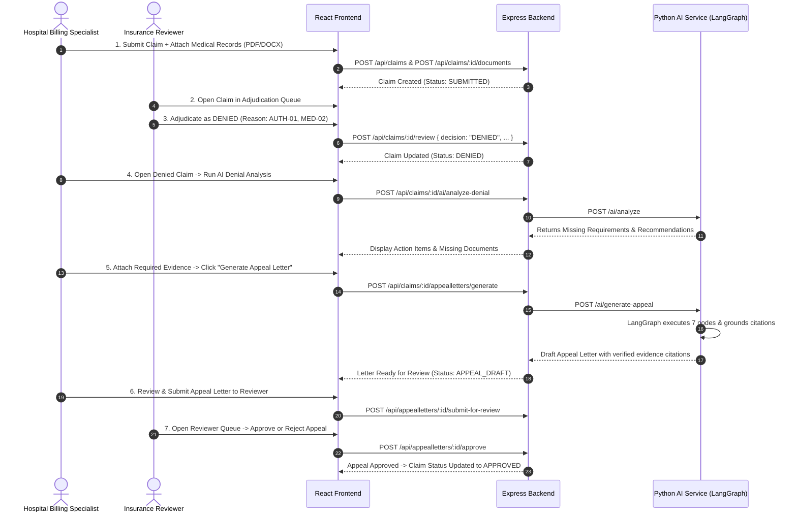

# Claim-Deny (HLT-06) · Claim Denial & Appeal-Letter Assistant

**AI-powered healthcare application that analyzes insurance claim denials, identifies missing medical evidence, and generates evidence-grounded appeal letters using React, Node.js, Express, Python, FastAPI, LangGraph, and Ollama.**

**Domain:** Healthcare — Revenue Cycle Management (RCM)  |  **AI Core:** Denial-Reason Analysis + Grounded Appeal Drafting  |  **License:** MIT

---

## 1. Executive Summary & Problem Statement

In healthcare revenue cycle management, healthcare providers face an initial claim denial rate of **15% to 20%**. Appealing these denials manually is labor-intensive (taking 45 to 60 days on average), prone to administrative errors, and frequently fails because appeal letters do not cite the exact clinical notes and diagnostic evidence required by payer medical policies.

**HLT-06 (Claim-Deny)** is a full-stack, enterprise-grade, human-in-the-loop platform bridging **Healthcare Providers (Hospital Billing Specialists)** and **Insurance Payers (Compliance Reviewers)**. It automates:

1. **Hospital Claim Submission**: Multi-document clinical attachments (PDF, DOCX) linked to patient diagnosis (ICD) and procedure (CPT/PCS) codes.
2. **Payer Adjudication**: Standardized Claim Adjustment Reason Codes (CARC/RARC) like `AUTH-01`, `MED-02`, and `DOC-01` with reviewer feedback.
3. **AI Denial Analysis**: Automated cross-examination of reviewer feedback against clinical policy rules to identify missing medical documentation.
4. **Grounded Appeal Drafting**: LangGraph-orchestrated appeal letter formulation citing verified excerpts from uploaded medical records to prevent hallucinations.
5. **Reviewer Certification & Audit**: Approval and rejection workflows with strict role-based access control (RBAC) and structured zero-PHI audit logging.

---

## 2. System Architecture

The application is structured into a 3-tier microservice architecture:



---

## 3. Technology Stack

### Frontend
- **Framework:** React 19 (Vite SPA)
- **Styling:** Tailwind CSS v4 (`@tailwindcss/vite`)
- **Routing:** React Router v8 with `<RoleGuard>` and `<ProtectedRoute>`
- **Icons:** Lucide React
- **Client Sync:** Multi-channel real-time sync (`BroadcastChannel`, `storage` events, and `CustomEvent` with 3-second polling fallback)
- **HTTP Client:** Fetch API client with automatic JWT token attachment and 401 expiration interceptor

### Backend API Gateway
- **Runtime:** Node.js (v20+) & Express 5
- **Database & ORM:** SQLite with Prisma 7 (`@prisma/adapter-better-sqlite3`, `better-sqlite3`)
- **Authentication:** Stateless JSON Web Tokens (`jsonwebtoken`, `HS256`, 8-hour expiry)
- **Security:** Helmet headers, CORS policy, password hashing via `bcryptjs`
- **Validation:** Zod schemas on all request parameters, queries, and JSON bodies
- **File Uploads:** Multer with file type verification and secure storage key assignment
- **Logging:** Structured JSON logs via `pino` and `pino-http`

### AI Microservice & Reasoning Pipeline
- **Framework:** Python 3.12 & FastAPI (`uvicorn`)
- **Orchestration:** LangGraph (`StateGraph`) stateful multi-node workflow
- **Model Client:** LangChain Core (`langchain_openai.ChatOpenAI`, `HumanMessage`, `SystemMessage`)
- **Local Inference:** Ollama running `llama3.2:1b` (zero external API keys, 100% private and local)
- **Validation:** Pydantic v2 models with strict JSON parsing and deterministic fallback routines
- **Safety & PII:** Regex-based sanitization and zero-hallucination source citation verification

---

## 4. LangGraph Multi-Node Workflow

Appeal analysis and drafting execute through a 7-stage directed acyclic state graph in `ai-service/pipeline/workflow.py`:



1. **`input_validation`**: Validates claim, denial, and evidence schemas.
2. **`denial_classifier`**: Categorizes denials into `MEDICAL_NECESSITY`, `AUTHORIZATION_REQUIRED`, `MISSING_INFORMATION`, `CODING`, or `ELIGIBILITY`.
3. **`evidence_mapper`**: Evaluates uploaded clinical notes against payer rules and identifies missing documentation.
4. **`evidence_analysis`**: Extracts verified findings, section names, and page numbers from source medical records.
5. **`appeal_drafter`**: Generates clinical and legal arguments rebutting the payer's denial reasoning.
6. **`grounding_validator`**: Cross-verifies every statement in the draft against uploaded evidence IDs to eliminate hallucinations.
7. **`final_response`**: Returns structured payload with citations, metadata, and audit confidence scores.

---

## 5. Repository Structure

```
Claim-Deny/
├── frontend/               # React 19 + Vite + Tailwind CSS SPA
│   ├── src/
│   │   ├── api/            # API client with automatic JWT Bearer headers
│   │   ├── components/     # AppShell, UI components (Button, Card, StatusBadge, etc.)
│   │   ├── context/        # AuthContext (JWT/roles), ToastContext
│   │   ├── lib/            # sync.js (cross-tab sync), format.js (currency/date), utils.js
│   │   ├── pages/          # Claims, Denials, Appeal Draft, Reviewer Queue, Admin
│   │   └── router.jsx      # Role-guarded routing (<RoleGuard>)
│   └── package.json
├── backend/                # Node.js + Express 5 Core API Gateway
│   ├── prisma/             # schema.prisma, migrations, seed.js
│   ├── src/
│   │   ├── app.js          # Express app initialization, CORS, Helmet, routes
│   │   ├── server.js       # HTTP server listener (port 3000)
│   │   ├── config/         # Environment variables & constants
│   │   ├── controllers/    # API controllers
│   │   ├── data-access/    # Repositories & Prisma client queries
│   │   ├── middleware/     # authenticate.js, authorize.js, validate.js, error-handler.js
│   │   ├── routes/         # api.routes.js
│   │   └── services/       # api.service.js, document.service.js, appeal-generation.service.js
│   └── package.json
├── ai-service/             # Python 3.12 FastAPI microservice
│   ├── main.py             # FastAPI entry point & endpoints (port 8001)
│   ├── document_parser.py  # Medical PDF/DOCX chunking & section parsing
│   ├── llm/                # client.py (Ollama), structured_output.py, prompts.py
│   ├── pipeline/           # workflow.py (LangGraph StateGraph), nodes.py, schemas.py
│   └── requirements.txt
├── docs/                   # Architecture blueprints, PRD, and API contracts
│   ├── PRD.md              # Product Requirements Document
│   ├── HLD_LLD_ARCHITECTURE.md # High-Level & Low-Level Design Architecture
│   ├── API_CONTRACT.md     # OpenAPI REST API specifications
│   ├── DATA_MODEL.md       # Entity-Relationship diagram & schema specifications
│   └── AI_SPEC.md          # AI pipeline, grounding rules, and evaluation spec
├── evals/                  # Evaluation harness and synthetic test cases
├── LICENSE                 # MIT License
└── README.md               # Project documentation (this file)
```

---

## 6. Setup & Installation Guide

### Prerequisites
- **Node.js**: v20+ & npm
- **Python**: 3.11 or 3.12
- **Ollama**: Installed and running locally ([ollama.ai](https://ollama.ai))

---

### Step 1: Clone the Repository
```bash
git clone https://github.com/phani41/Claim-Deny.git
cd Claim-Deny
```

---

### Step 2: Configure & Start Local Ollama
In a terminal, start Ollama and download the model:
```bash
ollama serve
ollama pull llama3.2:1b
```

---

### Step 3: Set Up the AI Microservice (Port 8001)
```bash
cd ai-service

# Create virtual environment
python -m venv .venv

# Activate virtual environment:
# Windows (PowerShell):
.venv\Scripts\activate
# Linux / macOS:
source .venv/bin/activate

# Install dependencies
pip install -r requirements.txt

# Start AI Service
python -m uvicorn main:app --host 127.0.0.1 --port 8001
```

---

### Step 4: Set Up the Backend API (Port 3000)
In a new terminal:
```bash
cd backend

# Install dependencies
npm install

# Apply database migrations & seed reference data
npm run db:deploy
npm run db:seed

# Start backend server
npm run dev
```

---

### Step 5: Set Up the Frontend SPA (Port 5173)
In a third terminal:
```bash
cd frontend

# Install dependencies
npm install

# Start Vite dev server
npm run dev
```

Open your browser at **`http://127.0.0.1:5173`**.

---

## 7. Pre-Seeded Demo Accounts

The database comes pre-seeded with accounts for all roles:

| Role | Email | Password | Access & Responsibilities |
| :--- | :--- | :--- | :--- |
| **Hospital Billing Specialist** | `billing@demo.in` | `Demo@123` | Submit claims, upload medical files, trigger AI denial analysis, draft appeal letters. |
| **Insurance Compliance Reviewer** | `reviewer@demo.in` | `Demo@123` | Adjudicate claims (Approve/Deny with reason codes), review and certify appeal letters. |
| **System Administrator** | `admin@demo.in` | `Demo@123` | Manage users, view system-wide audit logs, and inspect knowledge base documents. |

---

## 8. End-to-End Workflow Walkthrough



---

## 9. Verification & Testing

All test suites can be executed independently:

```bash
# 1. Backend integration, authorization, & multi-tenant isolation tests (9/9 pass)
cd backend
npm test

# 2. AI microservice workflow & LangGraph node tests (21/21 pass)
cd ai-service
pytest

# 3. Frontend production build validation (clean bundle)
cd frontend
npm run build

# 4. Evaluation set run
npm run eval
```

---

## 10. License

This project is open-source software licensed under the **[MIT License](LICENSE)**:

```
Copyright (c) 2026 VEDULAPURAM SAI PHANEENDRA KUMAR
Copyright (c) 2026 The KSquare Group — FDE Foundation Capstone
```
