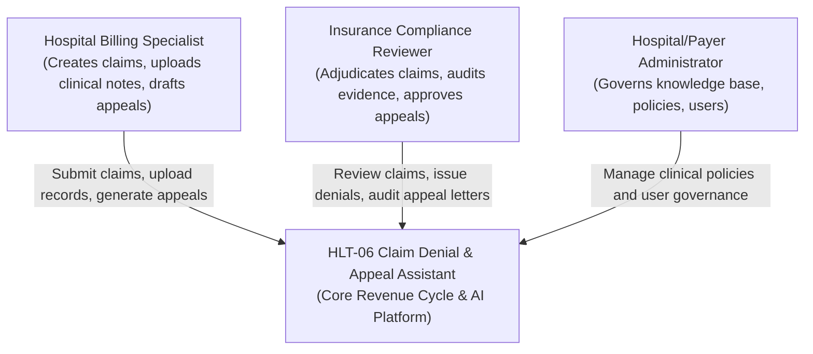
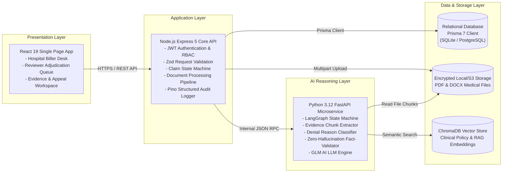
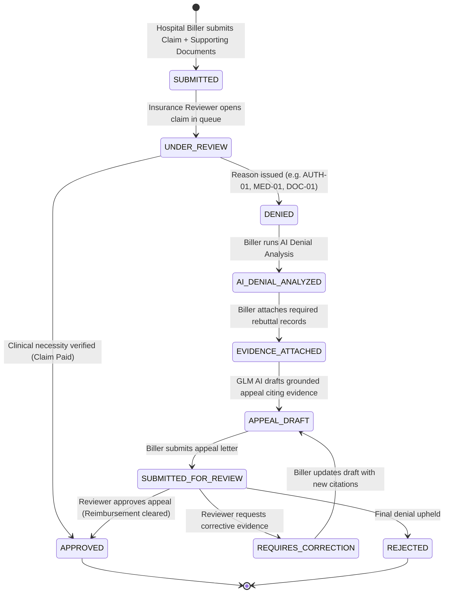
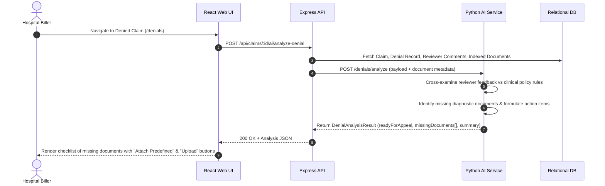
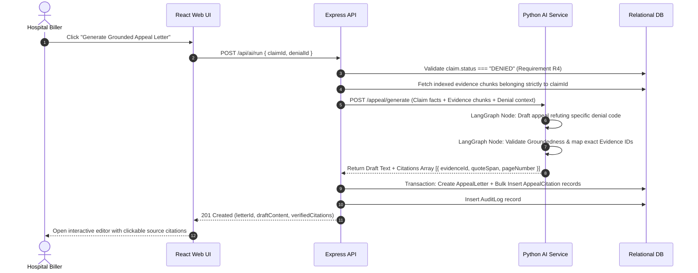
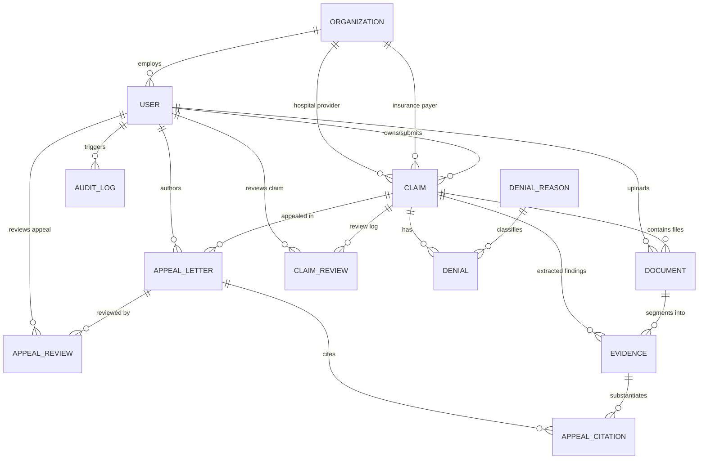
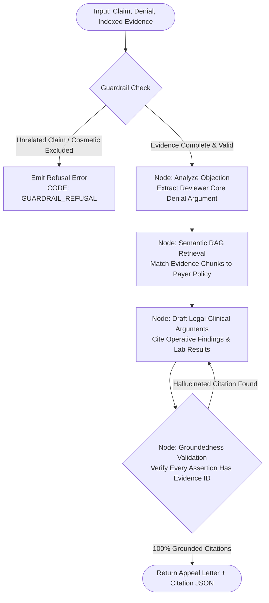

# HLT-06: Claim Denial & Appeal Letter Assistant
## High-Level Design (HLD) & Low-Level Design (LLD) Architecture Blueprint

---

# SECTION 1: HIGH-LEVEL DESIGN (HLD)

## 1. System Overview & Problem Statement
The healthcare revenue cycle suffers from a 15–20% initial claim denial rate across hospital systems and insurance payers. Manual denial appeal drafting is slow (averaging 45–60 days), prone to administrative errors, and often fails because appeals do not cite the exact clinical notes and diagnostic evidence needed by payer coverage guidelines.

**HLT-06** is an enterprise-grade, human-in-the-loop healthcare platform that connects **Healthcare Providers (Hospitals)** and **Insurance Payers (Compliance Reviewers)**. It automates:
1. Hospital claim submission with multi-document clinical attachments.
2. Payer claim adjudication with standardized denial reason codes (CARC/RARC).
3. Automated AI denial analysis that cross-examines reviewer feedback with clinical rules to highlight missing evidence.
4. RAG-driven grounded appeal drafting that formulates appeal letters with citations to indexed clinical records.
5. Reviewer certification and approval/rejection workflows with zero-PHI audit logging.

```
+----------------------------------------------------------------------------------------------------+
|                                    HLT-06 PLATFORM ARCHITECTURE                                    |
+----------------------------------------------------------------------------------------------------+
|                                                                                                    |
|    +-----------------------------+                           +--------------------------------+     |
|    |      Hospital Biller        |                           |       Insurance Reviewer       |     |
|    |  (Submit, Evidence, Draft)  |                           |     (Adjudicate & Certify)     |     |
|    +--------------+--------------+                           +---------------+----------------+     |
|                   |                                                          |                      |
|                   +----------------------------+-----------------------------+                      |
|                                                | HTTPS                                              |
|                                                v                                                    |
|                   +----------------------------------------------------------+                      |
|                   |                React 19 Single Page App                  |                      |
|                   |           (Tailwind CSS, Vite, SSE Sync)                 |                      |
|                   +----------------------------+-----------------------------+                      |
|                                                | /api (JSON + JWT)                                  |
|                                                v                                                    |
|                   +----------------------------------------------------------+                      |
|                   |              Node.js Express 5 API Gateway               |                      |
|                   |      (Zod Validation, Auth, RBAC, Pino Logging)          |                      |
|                   +--------------+-----------------------------+-------------+                      |
|                                  |                             |                                    |
|                     Prisma 7 /   |                             | HTTP / JSON                        |
|                     SQL Driver   |                             |                                    |
|                                  v                             v                                    |
|               +----------------------+           +---------------------------+                      |
|               | Relational Database  |           | Python AI Microservice    |                      |
|               | (SQLite / PostgreSQL)|           | (FastAPI, LangGraph, GLM) |                      |
|               +----------------------+           +-------------+-------------+                      |
|                                                                |                                    |
|                                                                | Embeddings / Vector Search         |
|                                                                v                                    |
|                                                  +---------------------------+                      |
|                                                  |   ChromaDB / Vector RAG   |                      |
|                                                  |   (Clinical Guidelines)   |                      |
|                                                  +---------------------------+                      |
+----------------------------------------------------------------------------------------------------+
```

---

## 2. C4 Context & Container Architecture

### 2.1 C4 Context Level


### 2.2 C4 Container Level


---

## 3. Core Business Workflows & Data Flows

### 3.1 End-to-End Revenue Cycle Lifecycle


### 3.2 Sequence: AI Denial Analysis & Missing Evidence Identification


### 3.3 Sequence: Grounded Appeal Generation with Claim-Owned Citations


---

## 4. Non-Functional Requirements (NFR) Architecture

| Category | Specification | Implementation Strategy |
| :--- | :--- | :--- |
| **Performance** | API Response < 200ms, AI Draft Generation < 3.5s | Streaming FastAPI responses, async document segmentation, indexed DB queries |
| **Security & RBAC** | Strict multi-tenancy & role isolation | JWT HS256 tokens, `buildClaimUserWhere` row-level scoping, BCrypt password hashing |
| **Privacy / HIPAA** | Zero-PHI Logging & minimum necessary access | Clinical text excluded from error logs, synthetic patient identifiers, stateless LLM calls |
| **Groundedness** | Zero hallucination guarantee | Hard relational foreign keys (`AppealCitation` &rarr; `Evidence`), refusal guardrail on missing records |
| **Fault Tolerance** | Graceful degradation if AI microservice offline | HTTP 503 circuit-handling, manual appeal drafting fallback, automated document reprocessing queue |

---

# SECTION 2: LOW-LEVEL DESIGN (LLD)

## 1. Relational Database Data Model & Schema Dictionary



### 1.1 Detailed Entity Specifications

#### Entity: `Organization`
*Represents hospitals, provider clinics, and insurance payers.*
- `id` (VARCHAR(64), PK): Unique organization ID (`org-hosp-01`, `org-ins-01`).
- `name` (VARCHAR(255), UNIQUE, NOT NULL): Official facility / insurer name.
- `type` (ENUM, NOT NULL): `HOSPITAL` | `INSURANCE_COMPANY`.
- `active` (BOOLEAN, DEFAULT true): Operational status.
- `createdAt` / `updatedAt` (TIMESTAMP).

#### Entity: `User`
*Authenticated user accounts with Role-Based Access Control (RBAC).*
- `id` (VARCHAR(64), PK): CUID / UUID string.
- `email` (VARCHAR(255), UNIQUE, NOT NULL): User sign-in email.
- `displayName` (VARCHAR(150), NOT NULL): Full name.
- `passwordHash` (VARCHAR(255), NOT NULL): BCrypt salt+hash (rounds = 10).
- `role` (ENUM, NOT NULL): `ADMIN` | `BILLING_SPECIALIST` | `COMPLIANCE_REVIEWER` | `PROVIDER` | `REVIEWER`.
- `organizationId` (VARCHAR(64), FK &rarr; `Organization.id`, NULLABLE): Enforces hospital or payer organizational boundary.
- `active` (BOOLEAN, DEFAULT true).

#### Entity: `Claim`
*Core healthcare claim entity submitted by hospital and adjudicated by payer.*
- `id` (VARCHAR(64), PK): Unique claim ID.
- `ownerId` (VARCHAR(64), FK &rarr; `User.id`, ON DELETE CASCADE): Billing specialist who filed the claim.
- `claimNumber` (VARCHAR(64), NOT NULL): Standard claim code (e.g. `CLM-IND-2026-09`).
- `patientName` (VARCHAR(150)): Patient name (synthetic or tokenized).
- `hospitalOrganizationId` (VARCHAR(64), FK &rarr; `Organization.id`): Submitting hospital facility.
- `insuranceOrganizationId` (VARCHAR(64), FK &rarr; `Organization.id`): Receiving insurance payer.
- `policyNumber` (VARCHAR(64)): Insurance policy ID.
- `diagnosisCode` (VARCHAR(50)): Primary ICD-10 code (`I21.9`, `K80.00`).
- `procedureCode` (VARCHAR(50)): Primary CPT/PCS code (`02703ZZ`, `47562`).
- `treatmentDescription` (TEXT): Clinical summary of the admission.
- `serviceDate` (DATETIME, NOT NULL): Date of admission or surgical procedure.
- `amount` (DECIMAL(12,2), NOT NULL): Billed claim value.
- `currency` (VARCHAR(10), DEFAULT 'INR'): Billed currency (`INR`, `USD`).
- `status` (ENUM, DEFAULT 'SUBMITTED'): `SUBMITTED`, `UNDER_REVIEW`, `DENIED`, `APPEAL_DRAFT`, `SUBMITTED_FOR_REVIEW`, `APPROVED`, `REJECTED`, `PAID`, `CLOSED`.

#### Entity: `DenialReason` & `Denial`
*Master catalog of denial codes and specific denial instances on a claim.*
- `DenialReason`:
  - `id` (VARCHAR(64), PK), `code` (VARCHAR(30), UNIQUE, e.g. `AUTH-01`, `MED-01`, `CO-16`), `category` (ENUM), `title` (VARCHAR(200)), `description` (TEXT), `rulesJson` (TEXT / JSON).
- `Denial`:
  - `id` (VARCHAR(64), PK).
  - `claimId` (VARCHAR(64), FK &rarr; `Claim.id`, ON DELETE CASCADE).
  - `denialReasonId` (VARCHAR(64), FK &rarr; `DenialReason.id`).
  - `reasonText` (TEXT): Detailed reviewer comments and audit explanation.
  - `status` (ENUM, DEFAULT 'OPEN'): `OPEN` | `APPEALED` | `RESOLVED` | `CLOSED`.
  - `denialDate` (DATETIME, DEFAULT NOW).

#### Entity: `Document` & `Evidence` (The RAG Subsystem)
*Decouples physical file uploads from structured, semantic evidence chunks.*
- `Document`:
  - `id` (VARCHAR(64), PK), `claimId` (FK &rarr; `Claim.id`), `uploadedById` (FK &rarr; `User.id`).
  - `originalName` (VARCHAR(255)), `storageKey` (VARCHAR(255)), `mimeType` (VARCHAR(100)), `sizeBytes` (INT).
  - `type` (ENUM): `CLINICAL_NOTE`, `IMAGING_REPORT`, `LAB_RESULT`, `ORDER`, `AUTHORIZATION`, `OTHER`.
  - `status` (ENUM): `UPLOADED` &rarr; `PROCESSING` &rarr; `EXTRACTED` &rarr; `INDEXED` (or `FAILED`).
- `Evidence`:
  - `id` (VARCHAR(64), PK), `claimId` (FK &rarr; `Claim.id`), `documentId` (FK &rarr; `Document.id`, NULLABLE).
  - `type` (ENUM): Clinical evidence classification.
  - `sourceLabel` (VARCHAR(150)), `summary` (TEXT): Cleaned clinical statement.
  - `content` (TEXT): Verbatim source excerpt.
  - `pageNumber` (INT), `sectionName` (VARCHAR(150)), `sourceDate` (DATETIME).

#### Entity: `AppealLetter` & `AppealCitation`
*AI-generated and specialist-edited formal appeal letters with guaranteed citations.*
- `AppealLetter`:
  - `id` (VARCHAR(64), PK), `claimId` (FK &rarr; `Claim.id`), `authorId` (FK &rarr; `User.id`), `reviewerId` (FK &rarr; `User.id`, NULLABLE).
  - `revisionNumber` (INT, DEFAULT 1), `subject` (VARCHAR(255)), `content` (LONGTEXT).
  - `status` (ENUM): `DRAFT`, `REQUIRES_CORRECTION`, `SUBMITTED_FOR_REVIEW`, `APPROVED`, `REJECTED`, `SUBMITTED`.
- `AppealCitation`:
  - `id` (VARCHAR(64), PK), `appealLetterId` (FK &rarr; `AppealLetter.id`, ON DELETE CASCADE), `evidenceId` (FK &rarr; `Evidence.id`).
  - `citationNumber` (INT), `quoteSpan` (TEXT), `sourceReference` (VARCHAR(255)).

#### Entity: `ClaimReview` & `AppealReview`
*Formal compliance audit decisions recorded by insurance reviewers.*
- `ClaimReview`: `id`, `claimId` (FK), `reviewerId` (FK), `decision` (`APPROVED` | `DENIED`), `denialCode`, `reviewComments`, `createdAt`.
- `AppealReview`: `id`, `appealLetterId` (FK), `reviewerId` (FK), `decision` (`APPROVED` | `REJECTED` | `REQUIRES_CORRECTION`), `reviewComments`, `createdAt`.

#### Entity: `AuditLog`
*Immutable audit trail capturing all critical actions.*
- `id` (PK), `userId` (FK), `action` (`CLAIM_CREATED`, `DOC_UPLOADED`, `AI_ANALYSIS_RUN`, `APPEAL_SUBMITTED`, `ADJUDICATED`), `resourceType`, `resourceId`, `ipAddress`, `createdAt`.

---

## 2. API Contract & Endpoint Specification

| Method | Endpoint | Authorized Roles | Purpose |
| :--- | :--- | :--- | :--- |
| `POST` | `/api/auth/login` | Public | Authenticates credentials, returns JWT bearer token |
| `GET` | `/api/claims` | Authenticated | Lists claims scoped to user's hospital/insurer organization |
| `POST` | `/api/claims` | Biller, Admin | Creates a new claim and enqueues for reviewer queue |
| `GET` | `/api/claims/:id` | Authenticated | Retrieves full claim packet, documents, reviews, and denials |
| `POST` | `/api/claims/:id/review` | Reviewer, Admin | Adjudicates claim: marks `APPROVED` or creates `DENIAL` record |
| `POST` | `/api/claims/:id/documents` | Biller, Admin | Uploads physical PDF/DOCX file and triggers async RAG extraction |
| `GET` | `/api/documents/:id/download` | Authenticated (Scoped) | Securely streams file to browser tab with JWT validation |
| `POST` | `/api/claims/:id/ai/analyze-denial`| Biller, Admin | Executes AI denial audit & missing document checklist |
| `POST` | `/api/ai/run` | Biller, Admin | Executes LangGraph pipeline to generate grounded appeal letter |
| `GET` | `/api/appealletters` | Authenticated | Lists appeal letters visible to author or assigned reviewer |
| `POST` | `/api/appealletters/:id/submit` | Biller, Admin | Submits drafted appeal to insurance compliance review queue |
| `POST` | `/api/appealletters/:id/approve` | Reviewer, Admin | Certifies and approves appeal, clearing claim reimbursement |
| `POST` | `/api/appealletters/:id/reject` | Reviewer, Admin | Rejects appeal or requests specific corrective evidence |

---

## 3. Python AI Microservice: LangGraph Pipeline Specification



### 3.1 LangGraph State Definition (`WorkflowState`)
```python
class WorkflowState(TypedDict):
    claim_id: str
    denial_code: str
    reviewer_comment: str
    evidence_chunks: list[dict]
    clinical_policy_rules: list[str]
    draft_letter: str
    citations: list[dict]
    groundedness_score: float
    validation_status: Literal["PASSED", "FAILED", "REFUSED"]
    error_message: Optional[str]
```

### 3.2 Refusal Guardrail Node Specification
Before invoking LLM drafting, the pipeline verifies:
1. **Clinical Necessity Evidence**: If zero clinical records exist, immediately refuse with `MISSING_CLINICAL_EVIDENCE`.
2. **Diagnosis & Procedure Mismatch**: If diagnosis ICD contradicts procedure CPT, flag conflict.
3. **Excluded Procedures**: If procedure is purely cosmetic or contractually excluded without medical emergency exception, refuse with `EXCLUDED_TREATMENT`.

---

## 4. Multi-Tenant Relational Isolation & Security Matrix

### 4.1 Row-Level Scoping Logic (`buildClaimUserWhere`)
To prevent data leakage across competing hospitals and payers, every query applies the following strict WHERE clauses:

```javascript
function buildClaimUserWhere(user) {
  if (user.role === "ADMIN") return {}; // System Administrator
  
  if (user.role === "BILLING_SPECIALIST" || user.role === "PROVIDER") {
    // Hospital Biller: Only claims belonging to their hospital organization or created by them
    return {
      OR: [
        { hospitalOrganizationId: user.organizationId },
        { ownerId: user.id }
      ]
    };
  }
  
  if (user.role === "COMPLIANCE_REVIEWER" || user.role === "REVIEWER") {
    // Insurance Reviewer: Only claims submitted to their insurance company or assigned to them
    return {
      OR: [
        { insuranceOrganizationId: user.organizationId },
        { appealLetters: { some: { reviewerId: user.id } } },
        { claimReviews: { some: { reviewerId: user.id } } }
      ]
    };
  }
  
  return { ownerId: user.id };
}
```

---

## 5. Verification & Testing Strategy

1. **Unit & Integration Test Suite** (`backend/scripts/test.js`):
   - Migrates an isolated SQLite test database per test run.
   - Tests JWT issuance, RBAC boundaries, claim creation, and multi-tenant isolation.
2. **AI Golden Evaluation Suite** (`evals/run_eval.js`):
   - 12 comprehensive clinical cases testing:
     - Denial classification accuracy ($\ge 90\%$)
     - Appeal groundedness ($\ge 95\%$)
     - Citation validity ($\ge 95\%$)
     - Safety refusal detection ($100\%$)
3. **Live Database Inspection**:
   - Web-based SQLite Studio on `http://localhost:5555/` allows inspecting table rows and relations in real-time.

